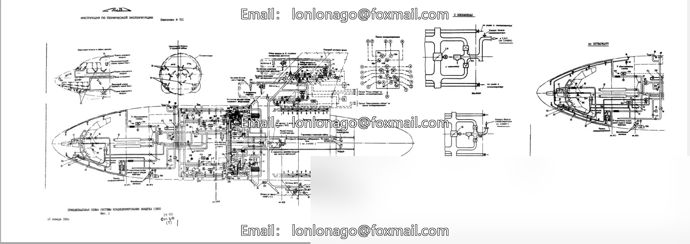
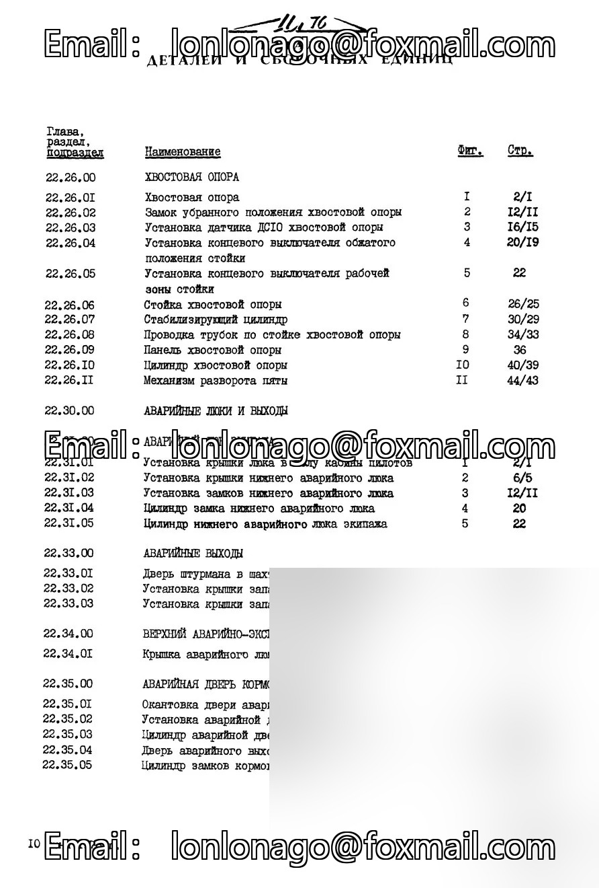
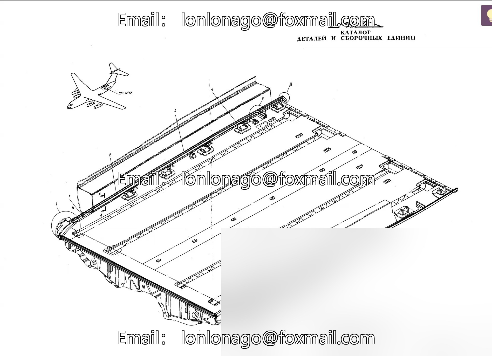
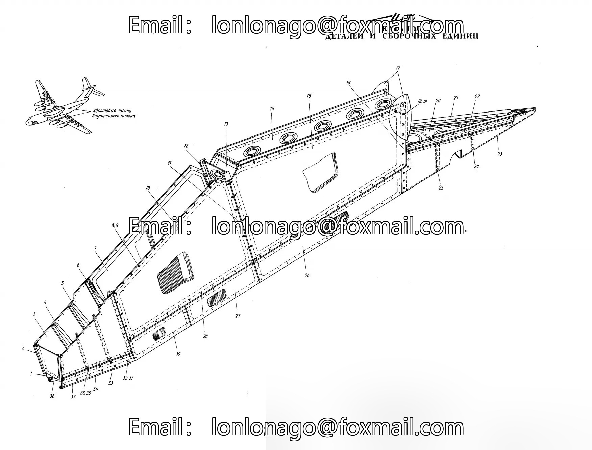
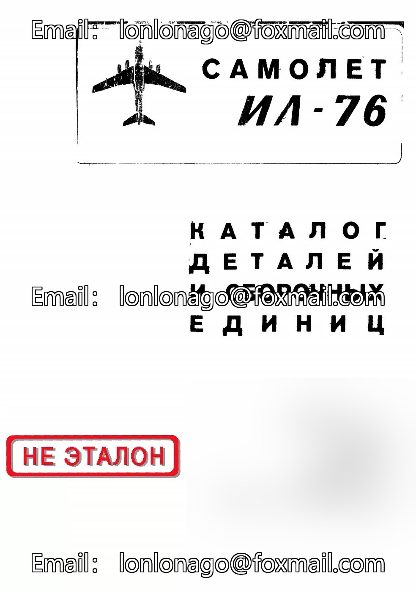
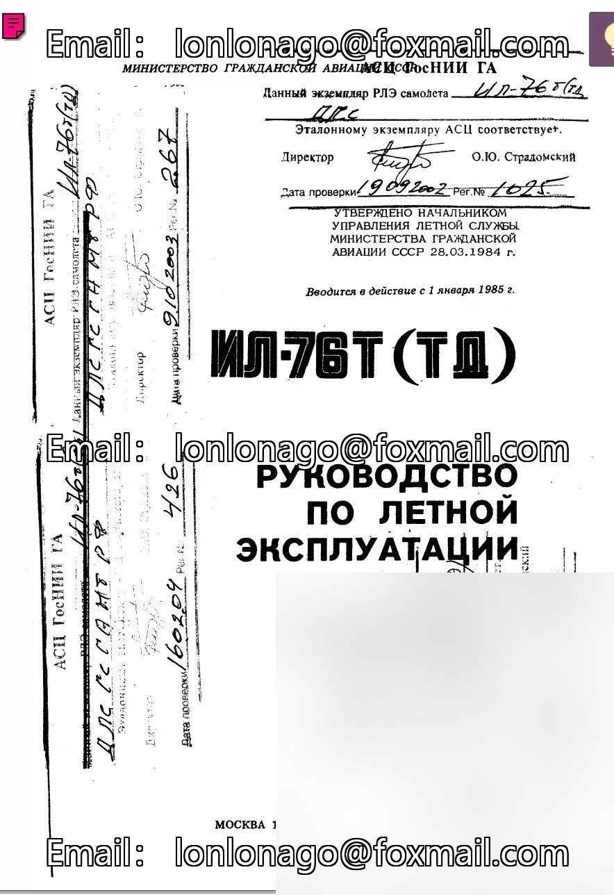
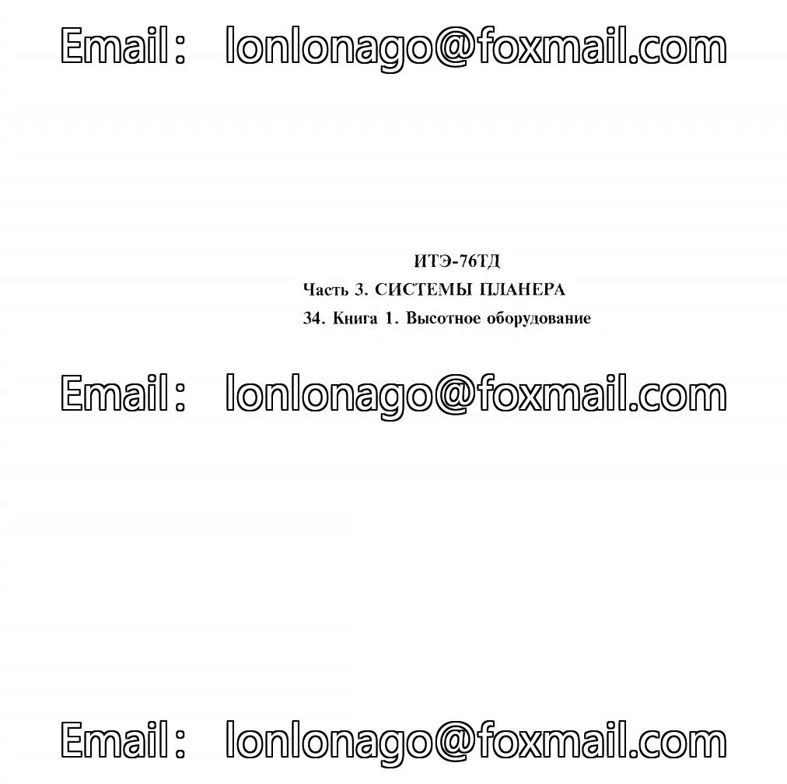
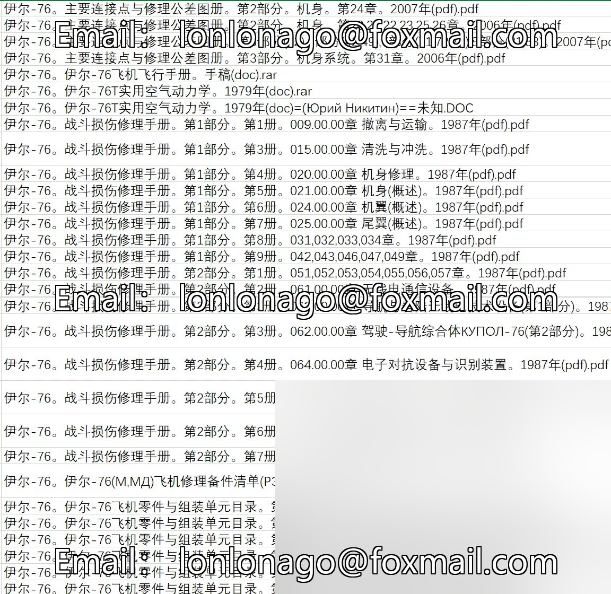

# Il-76 aircraft maintenance, parts, operation manuals, approximately 100 files, content across the entire network

## Body

I-76 aircraft maintenance, parts, and operation manuals, approximately 100 files, the most comprehensive content on the entire network!
Contains detailed drawings and instructions for the cabin system, avionics equipment, landing gear, etc. 1978 original materials, Russian version, complete content.
non-refundable if sold, non-reclaimable.

The Iral-76 aircraft maintenance, parts and operation manuals total about 100 files, covering body systems, avionics, landing gear, etc., with detailed drawings and explanations; it consists of 1978 original Russian-language materials with complete content.

<!-- AI_ENRICHED -->

## Images

## Payment

Here is a pay link on Stripe ( https://buy.stripe.com/3cs8yP7sY87d0vu9AB ). Please contact me lonlonago@foxmail.com after funding $89, and I will send you a complete data files , thank you!

